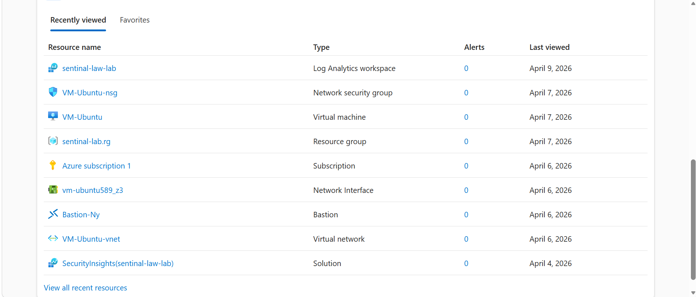
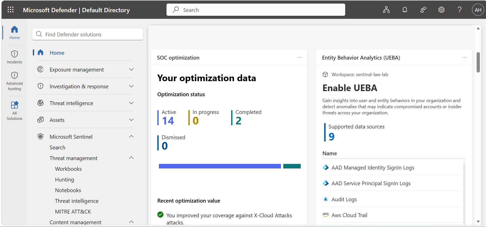
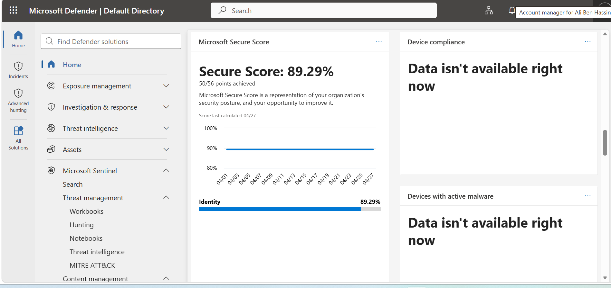

# SSH Brute Force Investigation

## Scenario

A simulated SSH password-guessing and username-enumeration scenario against an Azure Linux VM. The investigation used Syslog data in Microsoft Sentinel.

## Objective

Identify repeated failed SSH authentication attempts, compare activity by source IP, identify account-targeting patterns, and record an evidence-based assessment.

## Recorded results

| Source IP | Attempts | Account targeting |
|---|---:|---|
| `138.124.7.7` | 30 | `root` |
| `87.106.91.226` | 37 | 14 usernames |
| `192.252.215.125` | 22 | 15 usernames |
| **Total** | **89** | Multiple usernames |

A hunting bookmark was created for `138.124.7.7`.

## Analysis

The retained notes describe repeated failed SSH attempts and multiple usernames being tested. The activity is consistent with automated SSH brute-force attempts and username enumeration.

## Incident assessment

- **Observed:** 89 failed SSH attempts across three source IP addresses.
- **Observed:** Attempts against the `root` account from `138.124.7.7`.
- **Observed:** 14 usernames targeted from `87.106.91.226` and 15 from `192.252.215.125`.
- **Observed:** A hunting bookmark was created for `138.124.7.7`.
- **Not verified:** A successful SSH login.
- **Not established:** Unauthorized access or host compromise.

A successful SSH login was not verified in the available material. The report therefore does not claim that an attacker obtained access.

## Method

1. Filter Syslog messages for failed SSH password events.
2. Parse the username and source IP from the message.
3. Aggregate failed attempts by source IP.
4. Count distinct usernames where recorded.
5. Review the resulting patterns and bookmark the selected source for follow-up.

See [the KQL query](../../kql-queries/ssh-failed-login-analysis.kql) and [investigation methodology](../../documentation/investigation-methodology.md).

## Lab environment screenshots

### Azure resources

### Microsoft Sentinel / Defender

### Microsoft Secure Score

The Secure Score image provides context about the wider lab environment. It is not evidence of the SSH attack outcome.

## Evidence limitations

The screenshots above document the environment and portal context. The SSH findings are based on retained lab notes and query documentation; the screenshots do not independently verify the event counts or prove a successful login.
