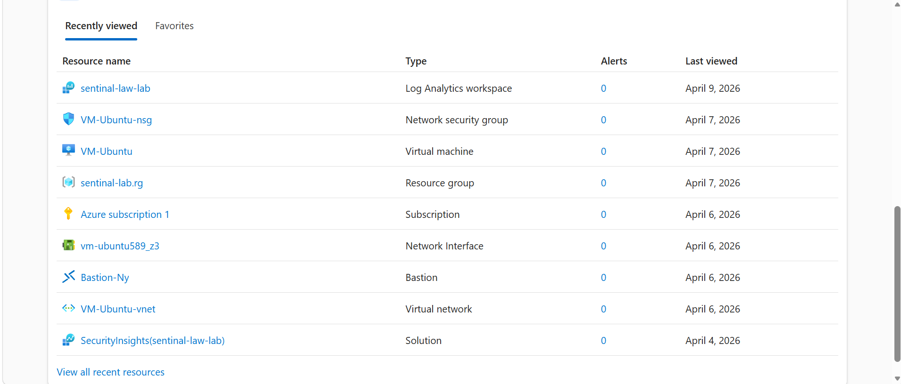
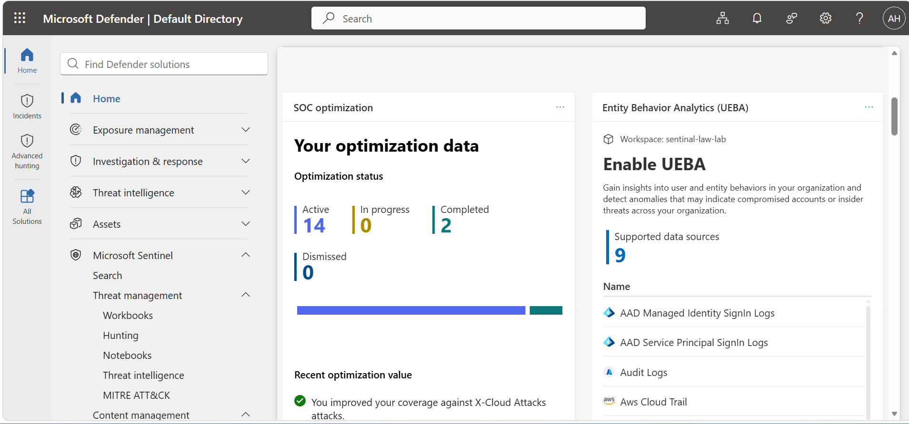
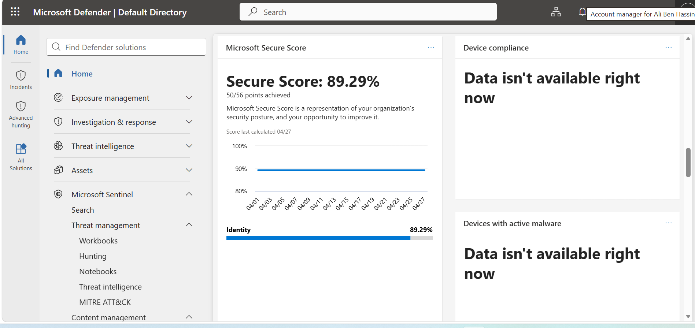

# Screenshot Evidence

These screenshots were retained from the April 2026 Microsoft Sentinel lab.

## 01 – Azure lab environment

Shows the Log Analytics workspace and related Azure resources used in the lab environment.

## 02 – Microsoft Sentinel / Defender overview

Shows the Microsoft Defender portal with Microsoft Sentinel navigation, SOC optimization information, and the UEBA panel.

## 03 – Microsoft Secure Score

Shows a Secure Score of 89.29% (50 of 56 points) in the captured portal view. This is contextual environment evidence, not a result attributed to the SSH investigation.

## Evidence boundaries

These screenshots document the Azure and Microsoft security portal environment. They do not independently prove the SSH event counts, a successful login, or system compromise. The investigation findings are documented separately in the incident report and are limited to the retained April 2026 material.
